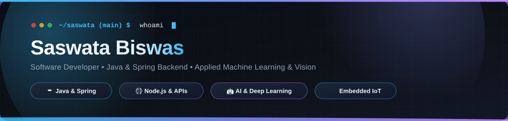

<div align="center">
  
</div>

<div align="center">
  <a href="https://github.com/SaswataNX05">
    
  </a>
</div>

<p align="center">
  <a href="mailto:sonubiswas268@gmail.com">
    
  </a>
  <a href="https://github.com/SaswataNX05">
    
  </a>
  <a href="https://linkedin.com">
    
  </a>
</p>

---

### 👨‍💻 About Me

```yaml
developer:
  name: Saswata Biswas
  handle: @SaswataNX05
  role: Software Developer
  core_stack: [Java, Spring Boot, Node.js, Python]
  interests: [Distributed Systems, Computer Vision, Embedded IoT]
  current_focus: Building modern desktop & backend systems
```

- 🔭 **What I'm building**: High-performance desktop applications with **Java Swing** and scalable backend services with **Spring Boot**.
- 🌱 **What I'm learning**: Modern asynchronous architectures with **Node.js** and distributed backend design.
- 💬 **Ask me about**: **Java**, Object-Oriented Design, Data Structures & Algorithms, and database systems.
- 🤖 **AI & Data Science**: Exploring practical machine learning with **PyTorch**, **TensorFlow**, and **OpenCV**.
- ⚡ **Fun Fact**: I love bridging software and hardware — from coding **Arduino** microcontrollers to architecting full-stack web applications.
- 📫 **Contact Me**: Reach me directly at **[sonubiswas268@gmail.com](mailto:sonubiswas268@gmail.com)**.

---

### 🛠️ Tech Stack & Toolkit

<div align="center">
  <a href="https://skillicons.dev">
    
  </a>
</div>

<br/>

<details open>
<summary><b>📂 Categorized Skills Matrix</b></summary>
<br/>

| Category | Technologies & Tools |
| :--- | :--- |
| **Languages** | `Java`, `C`, `C++`, `Python`, `JavaScript`, `HTML5`, `CSS3` |
| **Backend & Frameworks** | `Spring`, `Spring Boot`, `Node.js`, `Java Swing`, `Bootstrap` |
| **AI, ML & Data Science** | `PyTorch`, `TensorFlow`, `OpenCV`, `NumPy`, `Pandas`, `MATLAB` |
| **Databases** | `MySQL`, `MariaDB`, `MongoDB`, `Oracle Database` |
| **Tools & Platforms** | `Git`, `GitHub`, `Linux`, `Android Studio`, `Arduino` |

</details>

---

### 🏆 GitHub Trophies

<div align="center">
  <a href="https://github.com/SaswataNX05">
    
  </a>
</div>

---

### 📊 GitHub Activity & Metrics

<div align="center">
  
  
</div>

<br/>

<div align="center">
  
</div>

---

### 🤝 Let's Connect!

<p align="center">
  Whether you want to discuss a project, collaborate on open source, or talk tech, feel free to connect!
</p>

<p align="center">
  <a href="mailto:sonubiswas268@gmail.com">
    
  </a>
  <a href="https://github.com/SaswataNX05">
    
  </a>
  <a href="https://linkedin.com">
    
  </a>
</p>

<p align="center">
  <i>"Any fool can write code that a computer can understand. Good programmers write code that humans can understand."</i><br>
  — <b>Martin Fowler</b>
</p>

<div align="center">
  
</div>
